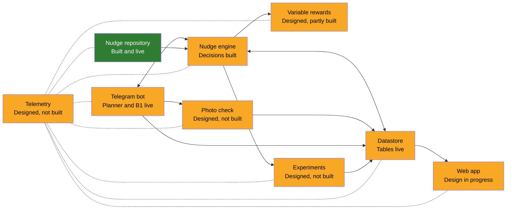

# Architecture

[2026-10-31 09:40 SGT] The **only** architecture diagram. Box labels: the official module name, then its status. Names and statuses must match the Module table in [docs/SPEC.md](SPEC.md) (section "Modules and structure"); the drift test (`tests/docs-drift.test.ts`) checks this, and checks that code only uses another module where an arrow connects them (rule S7). Telemetry's dotted lines: it listens to events from every module. The owner's original picture is kept as history in `docs/archive/architecture-diagram.png`.

**Colours:** [2026-11-11 17:48 SGT] green = built (a status starting with "Built"); yellow = in design or partly built; grey = "Not started" (rule D4).

SUPERSEDED [2026-11-11 17:48 SGT] **Colours:** green = built and tested; yellow = partly built or in design; grey = not started.

[2026-11-14 22:24 SGT] Statuses brought up to date: Web app "Design in progress" (the Week so far tab recorded, 14 Nov); Telegram bot "Planner and B1 live" (both went live on 14 Nov).

[2026-11-11 17:44 SGT] Statuses brought up to date (owner, 11 Nov). The drift test now also checks each box's colour fits its status (rule D4 in [docs/SPEC.md](SPEC.md)).
