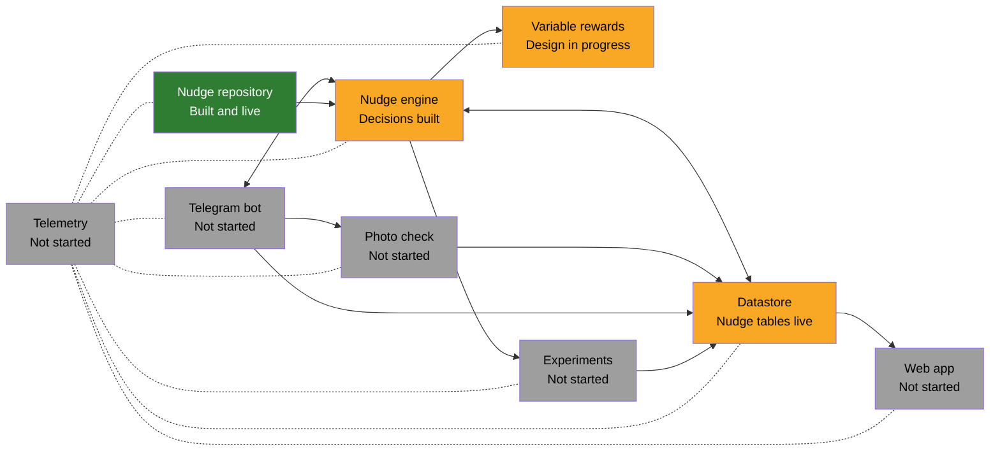

# Architecture

[2026-10-31 09:40 SGT] The **only** architecture diagram. Box labels: the official module name, then its status. Names and statuses must match the Module table in [docs/SPEC.md](SPEC.md) (section "Modules and structure"); the drift test (`tests/docs-drift.test.ts`) checks this, and checks that code only uses another module where an arrow connects them (rule S7). Telemetry's dotted lines: it listens to events from every module. The owner's original picture is kept as history in `docs/archive/architecture-diagram.png`.

**Colours:** green = built and tested; yellow = partly built or in design; grey = not started.
