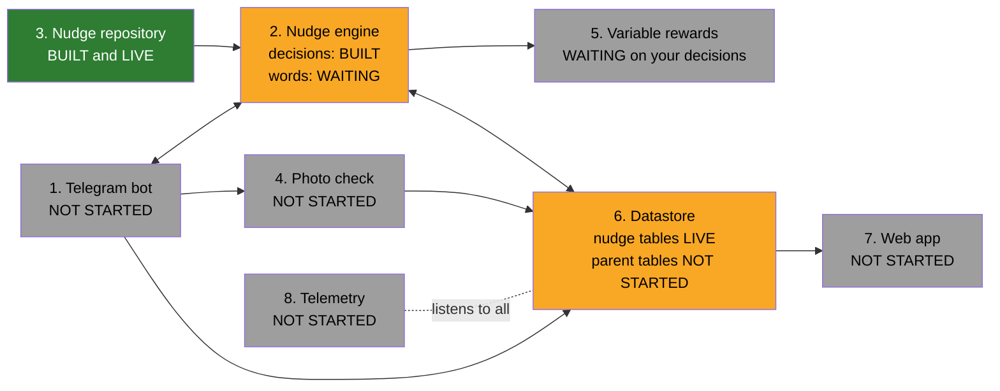

# Catch-up page: read this first after time away

**Last updated: [2026-10-28 22:36 SGT]** (end of session 3). Claude updates this page at the end of every session and shows it at the start of the next. Unlike the other project files, this page is a **current snapshot**: it is rewritten each time, and older versions stay in Git history. The dated, never-deleted record of each decision is in `docs/SPEC.md` (Change notes).

Contents: 1. Module map · 2. What each module does, and its files · 3. Rules recap (with rule IDs) · 4. Questions to think about before next session · 5. Waiting on you

---

## 1. Module map

The 8 modules from your architecture diagram, coloured by progress. Numbers match the table in section 2.

**Colours:** green = built and tested; yellow = partly built; grey = not started.

**Development order (agreed):** (1) Nudge repository, then Nudge engine decisions ✅ done → (2) Datastore with event log ⬅ **next after Batch 3** → (3) Telegram bot, first deploy → (4) Variable rewards, then Nudge engine words → (5) Photo check → (6) Telemetry → (7) Web app.

---

## 2. What each module does, and its files

A **module** is one box in the map. A **file** is a piece of code inside a module. Tests check that each file does what we agreed.

| # | Module | What it does (plain English) | Status | Files and what each one does | Tests |
|---|---|---|---|---|---|
| 1 | **Telegram bot** | The chat with the parent: sends nudge messages, receives logs, photos, ✅ Done and 😴 Not today | Not started | `api/health.ts`: an "I'm alive" web address, to check a deployment works | 2 |
| 2 | **Nudge engine** | The brain: checks what a parent picks, works out what is still to do, and decides when to nudge and about which behaviour. Later: Claude writes the words | Decisions half built | `shared/nudge-engine/choices.ts`: checks a parent's picks (2 quick + 1 deliberate, unlocked, frequencies) | 16 |
| | | | | `shared/nudge-engine/schedule.ts`: school day or non-school day; checks a parent's nudge times (slots); which times to grey out on screen | 8 |
| | | | | `shared/nudge-engine/due.ts`: is a behaviour still to do, given the frequency the parent chose? | 7 |
| | | | | `shared/nudge-engine/planner.ts`: the decision: "send a nudge about X now" or "don't send", with the reason | 22 |
| | | | | `shared/settings.ts`: all the numbers in one place (3 a day, slot times, limits); mirrors `docs/EXPERIMENTS.md` | (used by all) |
| | | | | `shared/sgt.ts`: Singapore time helpers (days, weekdays, time of day) | (used by all) |
| 3 | **Nudge repository** | The 9 nudges and their examples, which you edit in Supabase | Built and live | `shared/nudge-repository.ts`: checks every nudge and example row the app reads; leaves out broken ones and reports them | 23 |
| | | | | `supabase/seed/*.csv`: your 9 nudges and 45 examples (first load, done) | 6 |
| | | | | `supabase/content/2026-10-28_time_agnostic_examples.sql`: the 10 example rewrites (applied live) | checked |
| 4 | **Photo check** | Claude looks at a photo and judges whether it fits the behaviour | Not started | (none yet) | |
| 5 | **Variable rewards** | The 5 reward types: encouraging phrases, XP and levels, progress and streaks, snapshots, surprise bonus | Waiting on your decisions | (none yet) | |
| 6 | **Datastore** | Where everything is kept: Supabase (Singapore) for permanent records and photos, Upstash Redis for short-term chat memory | Nudge tables live | `supabase/migrations/001_create_nudge_repository.sql`: creates the nudges and examples tables, the 3-example guard and the browsing view | 25 database checks |
| | | | | `supabase/migrations/002_service_role_read_only.sql`: makes our server read-only on those tables | (in the 25) |
| 7 | **Web app** | Plain pages: history, progress, rewards, XP, "delete my data" | Not started | (none yet) | |
| 8 | **Telemetry** | Records events from every module and calculates your 10 success metrics | Not started | (none yet) | |

**Totals:** 84 app tests (`npm run check`) and 25 database checks (`npm run test:db`), all passing.

---

## 3. Rules recap (current rules only)

Each rule has a **rule ID** (e.g. **3.4**) so we can refer to it precisely. **IDs never change and are never reused:** a new rule gets the next free number in its section; a changed rule keeps its ID (with a new date); a dropped rule's ID is retired and listed at the end. Grouped by topic. The date in brackets after each rule, e.g. *(decided 24 Oct)*, is when you decided it (all dates 2026; two dates mean it was decided, then updated). The full history is in `docs/SPEC.md`.

### 1. Everyone and everything
- **1.1** Parents of children aged 7 to 12; each parent is a separate user. **Invite-only.** English only. Channel: Telegram. *(decided 24 Oct)*
- **1.2** All times and days are **Singapore time**, midnight to midnight. A week is **Monday to Sunday**. *(decided 24 Oct, 28 Oct)*
- **1.3** **No fallbacks:** a failure is shown as a failure, never filled with made-up values. Exception: if the photo check fails, the parent self-reports. *(decided 24 Oct)*

### 2. Nudge engine: what a parent picks
- **2.1** Up to **2 quick and 1 deliberate** behaviour, at least 1 in total. *(decided 25 Oct)*
- **2.2** Only **active** and **unlocked** nudges. 6 start unlocked: the 4 quick plus Spending quality time and Interesting activities. An **unlock opens more of the menu**; it never raises the 2 + 1 limit. How an unlock is earned: **WIP**. *(decided 25 Oct)*
- **2.3** Quick: **every day** or **every 2 days**. Deliberate: **1 or 2 times a week**, at most 2 in total. *(decided 24 Oct)*
- **2.4** The frequency is how often the parent wants to **do** it. We only nudge while it is still undone ("due"). *(decided 28 Oct)*

### 3. Nudge engine: when and what to nudge
- **3.1** **Nudge slots:** 30-minute blocks the parent picks, from 7:00am to the last one at 9:30pm. Up to **3 per schedule**, at least **1 hour apart**, at least **1 in total**. Slots are shared by all the parent's behaviours. *(decided 28 Oct)*
- **3.2** **Two schedules:** school days (Monday to Friday, not a public or MOE school holiday) and non-school days (everything else). *(decided 28 Oct)*
- **3.3** **Defaults** (pre-selected, one tap to keep): school days **7:00am, 7:00pm, 9:00pm**; non-school days **9:00am, 12:30pm, 7:00pm**. *(decided 28 Oct)*
- **3.4** At most **1 nudge message per slot** and **3 a day**. Replies never count. *(decided 28 Oct)*
- **3.5** Every nudge message has **✅ Done** and **😴 Not today**. Not today = no more that day, back tomorrow, no penalty; tracked as its own event. *(decided 28 Oct)*
- **3.6** Nothing is sent when: paused, Not today, nothing due, or the behaviour was just logged (re-checked right before sending). *(decided 28 Oct)*
- **3.7** **Due:** every day = not logged today; every 2 days = not logged today or yesterday; deliberate = fewer logs this week than chosen. *(decided 28 Oct)*
- **3.8** **Priority:** quick behaviours not logged for 2+ days first (longest first), then other quick, then deliberate; ties go to the one picked first. Each behaviour at most once a day. *(decided 28 Oct)*
- **3.9** A quick behaviour logged **7 days in a row** is nudged only every other day. *(decided 28 Oct)*
- **3.10** **Deliberate** behaviours are nudged on **Friday** (planning for the weekend) and **Sunday** (only if still due). *(decided 28 Oct)*
- **3.11** Any behaviour can go in any slot; **Claude adds the time-of-day context** to the words. *(decided 28 Oct)*

### 4. Nudge repository
- **4.1** Two tables you edit in Supabase: **nudges** (9 rows, settings written once, short codes TWC, SAF, DPR, GAT, SQT, IAC, SGE, ITE, ASD) and **examples** (unlimited, linked by code). *(decided 25 Oct)*
- **4.2** **4 quick:** Talking with children, Showing affection, Descriptive praise, Giving attention. **5 deliberate:** Spending quality time, Interesting activities, Setting a good example, Incidental teaching, Ask-say-do. *(decided 24 Oct)*
- **4.3** Each nudge has: self-report allowed, photo upload allowed (+ photo idea), description limit (280), active, starts unlocked. *(decided 24 Oct, 25 Oct)*
- **4.4** At least **3 active examples** per nudge: the database blocks edits that go below 3; the app flags new nudges below 3 (the nudge keeps working). *(decided 25 Oct)*
- **4.5** Examples are **time-agnostic** (no "at dinner", "before bedtime"). *(decided 28 Oct)*
- **4.6** Never delete: **retire** (active = no). A broken row is left out and reported; the rest keeps working. *(decided 25 Oct)*

### 5. Logging (Telegram bot and Datastore)
- **5.1** Parents can log **any time**: tap ✅ Done on a nudge message, a "Log something" button, or free text Claude understands. *(decided 28 Oct)*
- **5.2** **Unprompted** = no nudge message in the 4 hours before (metric 7). *(decided 28 Oct)*
- **5.3** Optional **description** (up to 280 characters) = the Hooked "Investment". Over 280: the bot asks to shorten it. Shown in the web app and snapshot, and given to Claude for future nudges. *(decided 24 Oct)*
- **5.4** Logging a behaviour not chosen: **accepted with thanks**, doesn't count toward targets. Logging late: **back to yesterday only**. Twice in a day: counts once for targets and streaks, but **should still be celebrated (WIP)**. *(decided 28 Oct)*
- **5.5** **Photos:** always optional; consent once at sign-up; kept until the parent deletes their data. *(decided 24 Oct)*

### 6. Photo check
- **6.1** Claude judges the photo, using the nudge's photo idea **for now** (risk: too strict, logged). If the check fails, the parent self-reports and the log is labelled "self-reported". *(decided 24 Oct)*

### 7. Variable rewards
- **7.1** 5 types: encouraging phrases, XP and levels, progress and streaks, "look how far you've come" snapshots (weekly and monthly, with a one-tap web link), surprise bonus. *(decided 24 Oct)*
- **7.2** **Surprise bonus:** on 20% of logged actions, double XP plus a special message. XP values and levels: **WIP**. *(decided 24 Oct)*
- **7.3** Streaks: a quick streak survives up to 2 missed days in a row; deliberate streaks are weekly. *(decided 24 Oct)*

### 8. Datastore
- **8.1** Supabase in **Singapore**; Upstash Redis (Singapore) for chat memory; Vercel functions in Singapore. *(decided 24 Oct)*
- **8.2** New tables start **locked** (Row Level Security on, no public access); our server can only read the nudge tables. *(decided 25 Oct)*

### 9. Web app
- **9.1** Plain, unstyled pages that show the right data; **the look comes from you later**. "Delete my data" lives here (WIP until UI design). *(decided 24 Oct)*

### 10. Telemetry
- **10.1** The **10 metrics** in `docs/Family_Habit_App_Success_Metrics.xlsx` (activation, adoption, stickiness, churn, drop-off, target-hit, unprompted, nudge-to-action, mute/stop, connection rating). "Not today" is its own event, not part of mute/stop. *(decided 24 Oct, 28 Oct)*

### Retired rule IDs
- None yet.

---

## 4. Questions to think about before next session

Answer whenever you have a moment (even on your phone, in the chat). Each has my suggestion, so "agree" is enough.

**Batch 3: surprise bonus and experiment groups (Nudge engine, decisions half)**
1. **Which logs can get the surprise bonus?** *Suggestion:* any log of a **chosen** behaviour, self-reported or photo alike (photos are optional, so they shouldn't earn more luck). Logs of unchosen behaviours and repeat logs: no surprise for now (they get their own celebration later, WIP).
2. **Pure luck, or a safety net?** With pure 20% luck, a parent can go 10+ logs without a surprise. *Suggestion:* pure luck to start (that is what "variable reward" means), and record every roll as an event so we can check fairness later.
3. **Where does the code read experiment settings from?** (a) `shared/settings.ts`, changed through a pull request, or (b) a Supabase table you edit. *Suggestion:* (a) for the trial: experiments are rare and should be reviewed and tested.
4. **First experiment at launch?** *Suggestion:* none at launch. Run the first one after 2 weeks of real data (e.g. surprise rate 20% vs 10%).
5. **When is a parent assigned to a group?** *Suggestion:* when an experiment starts, each active parent is randomly assigned once and stays in that group until it ends.

**Coming after Batch 3: the Datastore** (tables for parents, their picks, slots, logs and messages). No decisions expected from you; Claude will propose the tables.

---

## 5. Waiting on you (not blocking the next steps)
- XP values and levels; how an unlock is earned; celebrating repeat and unchosen logs (all with **Variable rewards**)
- Context collected from parents for AI nudge messages; nudge personality (`docs/NUDGE-CONTEXT.md`); how much free chat the bot supports
- Trial length (needed for metrics 6 and 7)
- **Before launch:** upload MOE school holiday and Singapore public holiday dates
- UI look (Web app and setup screens)
