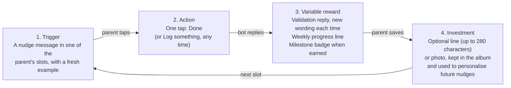

# Variable Rewards Spec (v0.2 draft, adapted to our rules)

[2026-10-29 22:02 SGT] Draft by Claude for the owner's review. Based on the owner's v0.1 (`docs/variable-rewards-spec-v0.1-original.md`, kept unchanged), adapted to the rules agreed so far (rule IDs from `docs/CATCH-UP.md`, section 3). Nothing here is final until the owner answers the decisions in section 1. Items marked "(tune)" are starting guesses to adjust after the trial.

**How to review:** read section 1 (decisions needed) and section 2 (what clashed and how it was resolved) first. Sections 3 onward are the adapted spec.

---

## 0. Universe of rewards and MVP scope

[2026-10-29 22:22 SGT] **Agreed by the owner:** the MVP rewards are features **1, 2, 3, 4, 6 and 10**, plus **snapshots (e)**, included because the MVP already collects photos. **Unlocks (f) are excluded from the MVP.**

| # | Reward | Source | Hooked category | Status |
|---|---|---|---|---|
| 1 | Validation reply after each log | v0.1 | Tribe | **MVP (agreed)** |
| 2 | Surprise activity card | v0.1 | Hunt | **MVP (agreed)**; how: folded into varied nudge messages (D6, to review) |
| 3 | Weekly streak | v0.1 | Self | **MVP (agreed)**; details D3 to D5 to review |
| 4 | Completion checklist (one-tap logging) | v0.1 | Self | **MVP (agreed)** |
| 5 | Co-parent reaction | v0.1 | Tribe | Later |
| 6 | Family memory album | v0.1 | Self | **MVP (agreed)** |
| 7 | XP and levels | v0.1; rules 7.1, 7.2 | Self | To decide (D1) |
| 8 | Social benchmarking | v0.1 | Tribe | Skip |
| 9 | Time-limited weekend challenge | v0.1 | Hunt | Skip |
| 10 | Three milestone badges | v0.1 | Self | **MVP (agreed)** |
| 11 | Per-activity badge collection | v0.1 | Self | Skip |
| 12 | Shared family badges | v0.1 | Tribe | Later |
| a | Double XP for unprompted logs | rule 7.2 | Hunt | To decide (D1) |
| b | Celebrating repeat logs and unchosen behaviours | rule 5.4 | Tribe | Within feature 1 |
| c | Encouraging phrases | rule 7.1 | Tribe | Same as feature 1 |
| d | Progress bar | owner, session 4 | Self | Same as feature 3 |
| e | "Look how far you've come" snapshots (weekly, monthly, one-tap web link) | spec Definition of done; rule 7.1 | Self | **MVP (agreed), folded into feature 6** (album) [2026-10-29 22:25 SGT]; timing D10 |
| f | Unlocks (earning a locked nudge) | rule 2.2 | Hunt | **Excluded from MVP (agreed)**; D11 answered [2026-10-29 22:25 SGT]: all 9 nudges start unlocked |

---

## 1. Decisions needed from the owner

Each has a suggestion; "agree" is enough. Numbers D1 to D9 are only for this review.

| # | Decision | Why it is needed | Suggestion |
|---|---|---|---|
| **D1** ✅ ANSWERED [2026-10-29 22:33 SGT]: XP and levels are out of the MVP (consistent with the agreed MVP list; reward 7). Rule 7.2's double XP is replaced by a special validation reply for unprompted logs. | **XP and levels: keep or drop?** v0.1 puts XP "later, or skip" (extrinsic, may crowd out real motivation). Tonight's rule **7.2** adds "double XP for unprompted logs". | The two clash. Both cannot hold. | **Drop XP and levels for the MVP** (follow v0.1 and its research). Replace 7.2's reward for unprompted logs with a **specific validation message** that notices the parent did it on their own (feature 1). Revisit XP at the trial review. |
| **D2** ✅ ANSWERED [2026-10-29 22:37 SGT]: Claude writes the replies; the bot first sends an honest receipt ("✅ Saved: Showing affection, today."), then Claude's warm reply. If Claude fails, the receipt stands and the failure is recorded. | **Validation replies: a written library, or written by Claude?** v0.1 uses a library of 20+ variants. Our spec says nudge messages are AI-written (v1.1). | Rule 1.3 (no fallbacks): if Claude fails, the parent would get no reply, which breaks v0.1's "every log always gets a reply". | **A library you review**, stored as data in Supabase like the examples (edit without code). Claude is not needed for replies in the MVP. |
| **D3** ✅ ANSWERED [2026-10-29 22:37 SGT]: weekly model adopted; rule 7.3 changed. | **Streaks: per behaviour (rule 7.3) or weekly (v0.1)?** | Rule 7.3 (quick streak survives 2 missed days; deliberate weekly) is complex. v0.1's weekly model is simpler and research-backed. | **Adopt the weekly model** and retire rule 7.3. |
| **D4** ✅ ANSWERED [2026-10-29 22:37 SGT]: steady week = own chosen frequency with some slack (bars in rule 7.6). | **What makes a "steady week"?** v0.1: at least 3 logged days. | Clash with rule 2.1 (user-led): a parent who chose only 1 deliberate behaviour once a week can never reach 3 days, so they could never earn a steady week or a badge. | **A steady week = the parent met their own chosen frequency for the week** (the same idea as metric 6, target-hit). Example: chose "Showing affection, every 2 days" → 3 or 4 logged days that week. |
| **D5** | **Repair pass: keep?** v0.1: one free pass a week, up to 48 hours after a missed day. | Clash with rule 5.4 (log back to yesterday only), and it adds a new mechanic to explain. With D4, a steady week already tolerates missed days. | **No repair pass in the MVP.** Logging up to yesterday (5.4) plus "own frequency" (D4) covers forgetful days. Revisit if parents ask. |
| **D6** | **Surprise activity cards: separate feature, or folded into nudge messages?** | v0.1's cards replace "the daily prompt" at random. We have no single daily prompt (we have slots, rule 3.1), we dropped the random surprise (7.2), and cards outside the 9 nudges are out of scope. | **Fold into nudge messages:** each nudge message uses a different example (no repeats until all are used), so every message is a small surprise. v0.1's cards become **new example rows** under the matching nudge (section 7). Add an **"Another idea"** button (v0.1's Swap), once per message. |
| **D7** | **Weekly album prompt: allowed, and does it count toward the 3-a-day cap?** | v0.1 adds a Sunday-evening prompt. Rule 3.4 caps bot-initiated messages at 3 a day. | **Allowed, once a week, in the parent's last Sunday slot, and it counts as one of that day's nudge messages.** Sent only if the parent logged at least once that week (nothing to save otherwise). |
| **D8** | **Album photos: only from logs, or any photo?** | Rule 4.3: photos are allowed only for nudges with "photo upload allowed" (the 5 deliberate ones). v0.1's weekly prompt invites any photo. | **The weekly prompt may take a photo or a line about any moment that week**, saved as an album entry (not a log, so no target, streak or badge effect). Photo rules 5.5 (optional, consent, kept until deleted) apply. |
| **D10** (partly answered [2026-10-29 22:25 SGT]: snapshots are part of feature 6, the album; timing still to confirm) | **Snapshots: what and when?** (added [2026-10-29 22:22 SGT]) | Agreed for the MVP; the Definition of done requires them. Each is a bot-initiated message, so rule 3.4 (cap) applies. | **Weekly:** in the parent's last Sunday slot, **combined with the album prompt (D7)** into one message: days this week, steady weeks so far, photos and lines saved this week, a one-tap web link, and "want to save one more moment?". **Monthly:** on the 1st of the month, in the parent's first slot: the month's numbers, a few saved photos or lines, and the link. Each counts as one nudge message that day. |
| **D11** ✅ ANSWERED [2026-10-29 22:25 SGT]: (a) all 9 start unlocked (rule 2.2 changed). | **Locked nudges without unlocks** (added [2026-10-29 22:22 SGT]) | Unlocks are out of the MVP, but rule 2.2 locks 3 deliberate nudges (Setting a good example, Incidental teaching, Ask-say-do). Without unlocks they can never be picked. | Choose: **(a) start all 9 unlocked in the MVP** (parents see the full menu; unlocks return later), or **(b) keep the 3 locked and simply unavailable in the MVP** (a smaller, simpler menu of 6). |
| **D9** | **Trial length** (open since session 1, needed by metrics 6 and 7). v0.1 suggests 5 weeks with 5 to 10 families. | Metrics 6 and 7 need at least 4 weeks. | **5 weeks**, 5 to 10 friends' families to start (within our capacity of 50). |

---

## 2. What clashed with our rules, and the resolution in this draft

| v0.1 says | Our rule | Resolution in v0.2 |
|---|---|---|
| Nudge "one small bonding action" | 4.2: 9 nudges (4 quick, 5 deliberate); 2.1: parent picks up to 2 + 1 | Rewards cover all 9 nudges; samples are mapped to nudge codes |
| Checklist buttons [Praised effort] [Asked about feelings] [Played together] [Something else] [Skip today] | 3.5: ✅ Done and 😴 Not today on every nudge message; 5.1: "Log something" any time | Buttons = our Done / Not today; "Log something" lists the parent's chosen nudges plus "Something else" (unchosen, rule 5.4) |
| "Skip today" | 3.5 "Not today" | Same thing; we keep the name "Not today" |
| One daily prompt plus one weekly album prompt, nothing more | 3.1, 3.4: up to 3 slots a day, at most 3 nudge messages a day | Our slots and cap apply; album prompt per D7 |
| Surprise activity card on ~3 random days a week | 7.2: random surprise dropped; 3.1 slots; out of scope: strategies not in the 9 nudges | D6: folded into nudge messages as varied examples |
| [Swap] on a card | (new) | D6: "Another idea" button, once per message |
| Weekly streak, 3 logged days, 48-hour repair pass | 7.3 per-behaviour streaks; 5.4 log back to yesterday only; 2.1 user-led frequency | D3, D4, D5 |
| XP and levels: later or skip | 7.1, 7.2 (XP, double XP for unprompted logs) | D1 |
| Validation library of 20+ variants | v1.1: AI-written messages; 1.3 no fallbacks | D2 |
| Photos text-only until privacy review | 5.5: photos optional, consent at sign-up, kept until deleted | Keep 5.5 (already decided); the open PDPA (Personal Data Protection Act) risk stays in `docs/KNOWN-ISSUES.md` |
| Album "send a photo or one line" for any moment | 4.3: photos only on nudges that allow them | D8 |
| Album lines come from "optional one line" after a tap | 5.3: optional description up to 280 characters = the Investment step | Same thing: the album shows log descriptions and photos |
| Test plan: 5 to 10 families, 5 weeks, its own measures | 10.1: our 10 metrics; trial length open | D9; v0.1's extra measures added alongside ours (section 8) |
| Connection rating at weeks 1 and 5 | Metric 10: optional weekly question | Keep weekly (it includes weeks 1 and 5) |
| Prompt time is an open question | 3.1 to 3.3: parent-chosen slots with defaults | Answered by our slots |
| Badges "on the album timeline" (a look) | Rule 6 of `CLAUDE.md`: look comes only from the owner | This spec says what and when; graphics come from the owner |
| Collect "a first name or nickname, no school" | WIP: context collected for nudge messages | Adopted as the starting point for that WIP item |

**Kept from v0.1 unchanged (fits our rules):** the design principle (easy first, informational not controlling), "every log always gets a reply", no guilt or "you missed a day", no comparison or leaderboards, permanent private badges, no countdowns or fear-of-missing-out wording, the Manipulation Matrix check, parent can pause at any time.

---

## 3. Purpose and scope

The Variable rewards module makes logging a bonding moment feel noticed and worthwhile, without turning family time into points. **Design principle (from v0.1):** make the action easy first, vary the reward second, and keep every reward **informational** ("here is what you did") rather than **controlling** ("do this to earn points") (Fogg Behavior Model; Deci, Koestner and Ryan 2001).

**In the MVP (if the suggestions in section 1 are agreed):**
- Feature 1: Validation reply after every log
- Feature 2: Varied nudge messages ("Another idea"), replacing separate surprise cards
- Feature 3: Weekly progress and steady weeks
- Feature 4: One-tap logging (our Done / Not today / Log something)
- Feature 6: Family memory album
- Feature 10: Three milestone badges

**Not in the MVP:** XP and levels (D1), repair pass (D5), co-parent reaction, shared family badges, per-activity badges, social benchmarking, time-limited challenges (section 10).

---

## 4. The hook loop, in our app

The Telegram bot carries steps 1 to 3 so the action stays one tap; the Web app mirrors progress and holds the album.

---

## 5. Features

### Feature 1: Validation reply (Tribe)
- **When:** after every log (Done, Log something, or a free-text log). **Every log always gets a reply** (v0.1 section 6). Replies never count toward the 3-a-day cap (rule 3.4).
- **What:** one short, warm message that names what the parent did, chosen from a **library of variants per nudge code** (D2), at least 3 per nudge to start (tune), 20+ in total.
- **Variety:** never repeat a variant within the parent's last 10 replies (tune).
- **Special replies (still from the library):**
  - **Unprompted log** (no nudge message in the 4 hours before, rule 5.2): a variant that notices they did it on their own (replaces double XP if D1 is agreed).
  - **Repeat log** of the same nudge in a day, or a **behaviour they didn't choose** (rule 5.4): a variant that celebrates the extra effort (closes the "celebrate repeat logs" WIP item).
- **Rules:** praise the action, not the parent as a person; no points; no comparison; never mention a missed day.
- **Web app:** the latest reply on the Today page; past replies kept with the album entry for that day.

### Feature 2: Varied nudge messages (Hunt), replacing surprise cards
- Each nudge message carries **one example** for the behaviour being nudged, chosen at random among the nudge's active examples **not yet used for this parent**; repeats only after all have been used (D6).
- Claude adds the time-of-day framing (rule 3.11). The example list itself lives in the Nudge repository (rule 4.1), so new ideas are new example rows.
- **"Another idea" button** (v0.1's Swap): swaps in a different example, **once per nudge message** (tune). Does not count as a new nudge message.
- v0.1's starter cards become example rows (section 7).
- **Web app:** "Ideas you've tried": examples the parent marked Done, with dates. No locked slots, no counts.

### Feature 3: Weekly progress and steady weeks (Self)
- A week is **Monday to Sunday**, Singapore time (rule 1.2).
- **Headline:** "days this week" with a log of any chosen behaviour.
- **Steady week (D4):** the parent met **their own chosen frequency** for each chosen behaviour that week. Tolerates missed days by design; no repair pass (D5).
- **Steady weeks count:** total steady weeks, and weeks in a row.
- **Telegram bot:** a progress line in each validation reply, e.g. "3 days this week." A short week never gets a "broken streak" message; Monday's first message may say "New week, fresh start."
- **Web app:** a weekly view of days done and steady weeks (look from the owner).
- Replaces rule 7.3 if D3 is agreed.

### Feature 4: One-tap logging (Self)
- **On every nudge message:** ✅ Done, 😴 Not today (rule 3.5), and "Another idea" (feature 2).
- **Any time:** a "Log something" menu listing the parent's chosen nudges plus "Something else" (rules 5.1, 5.4), one tap each.
- After the tap: "Want to add one line?" (optional description, up to 280 characters, rule 5.3) and, for nudges that allow it, an optional photo.
- **Not today has no penalty** and is never called a failure.

### Feature 6: Family memory album (Self, investment)
- **Holds:** the optional descriptions and photos from logs (rules 5.3, 5.5), plus entries from the weekly album prompt (D8).
- **Weekly album prompt (D7):** in the parent's last Sunday slot, only if they logged that week: "Want to save one moment from this week? Send a photo or one line." Counts toward that day's cap.
- **Web app:** a simple monthly timeline, private to the parent who saved it; the parent can delete any entry (and all data, rule 9.1).
- **Privacy:** photos optional; consent once at sign-up; kept until deleted (rule 5.5). The open PDPA retention risk stays in known issues.

---

## 6. Feature 10: Three milestone badges (Self)

| | First Steady Week | Four Steady Weeks | First Memory |
|---|---|---|---|
| **Earned when** | The first steady week (D4) | 4 steady weeks in total, not necessarily in a row | The first line or photo saved (log description, log photo or weekly album entry) |
| **Bot message** (draft) | "Your first steady week: you did what you set out to do with your child. Badge earned: First Steady Week." | "Four steady weeks so far. That's a month of showing up." | "Your first saved memory. It's in your album now." |
| **Web app** | Shown on the album timeline at that week | Shown at the date earned | Shown on that first entry |

**Rules for all badges (from v0.1):** permanent (never lost, not affected by a short week); for consistency and effort only, never volume; private, no comparison; no locked or empty badge slots; never paired with points or prizes; no new badges until the trial review. **Graphics come from the owner** (`CLAUDE.md` rule 6).

---

## 7. Starter content mapped to our nudges (drafts to test)

### Validation replies (feature 1), by nudge code
| Code | Draft reply |
|---|---|
| DPR (Descriptive praise) | "You noticed the effort, not just the result. That tells your child that trying matters." |
| DPR | "Praising the try instead of the score takes practice. You did it today." |
| TWC (Talking with children) | "You asked how your child felt, not just what happened. That kind of question says you want to hear the answer." |
| TWC | "Making room for feelings takes patience. Today you did." |
| SQT (Spending quality time) / IAC (Interesting activities) | "Time spent playing together counts. Thanks for joining in." |
| SQT / IAC | "You put the day aside and played. That might be the part your child remembers." |
| Something else (unchosen) | "Whatever you did, you made time for your child today. That counts." |
| Any (unprompted) | "No reminder needed today. You did this on your own." *(new draft)* |
| Any (repeat log) | "Twice today. A small moment, noticed and logged. That's how this adds up." *(adapted)* |

Still needed before launch: replies for SAF, GAT, SGE, ITE, ASD, at least 3 per code (who writes and reviews them: open question, section 10).

### v0.1 surprise cards as new examples (feature 2)
| Card (v0.1) | Becomes an example under | Note |
|---|---|---|
| "Ask your child: what was the funniest thing that happened today? Then tell yours." | TWC | Overlaps example ID 2; keep one |
| "Ask your child to teach you something they learned this week." | TWC | |
| "Tell your child about something you were proud of when you were their age." | TWC | |
| "Share one small thing that was tricky for you today and what you did about it." | SGE (Setting a good example) | Models handling difficulty |
| "Play three rounds of 'would you rather' with silly choices." | SQT | |
| "Take turns drawing each other in 60 seconds. No judging." | IAC | |
| "Pick a song and each say what it reminds you of." | TWC | |
| "Build a three-sentence story together, one sentence each." | IAC | |

All are time-agnostic (rule 4.5). They would be added as example rows after the owner approves, with a content script like the one used for the rewrites.

---

## 8. Success measures and trial

**Trial (D9):** 5 to 10 friends' families for 5 weeks (tune). Our **10 metrics** (rule 10.1) remain the main measures. v0.1's extra questions are added:

| Question (v0.1) | Measure | Maps to |
|---|---|---|
| Do parents keep logging? | Logged days per week; steady weeks | Metrics 3 (stickiness), 6 (target-hit) |
| Is the action easy enough? | Share of nudge messages followed by a log; one-tap vs typed logs | Metric 8 (nudge-to-action) + new: one-tap share |
| Do the varied examples land? | Done, Not today and "Another idea" rates per example | New; cut examples with high Not today or "Another idea" |
| Do parents feel closer? | Weekly 1 to 5 connection rating | Metric 10 |
| Is the reward crowding out the real thing? | Logs bunched on Sunday; parents saying they logged "for the badge" | New; end-of-trial interview |
| Do parents trust the album? | Photos saved, entries deleted, privacy comments | New; end-of-trial interview |

**Before the trial:** write a pass line for each measure. **At the review:** keep what clears its line; decide on badges, XP and the "Later" items.

---

## 9. Guardrails (from v0.1, adapted)

- **Ethics (Manipulation Matrix):** would you use this with your own family, and does it make family life better? If a feature fails either question, cut it.
- **Privacy:** rule 5.5 for photos; collect the least needed (first name or nickname, no school, no full name) as the starting point for the "context collected" WIP item; albums private; any entry deletable; formal privacy review before any public launch.
- **Tone and pressure:** no guilt, no comparison, no "you missed a day"; no countdowns or limited-time offers; nudge messages only in the parent's own slots, at most 3 a day, plus the weekly album prompt inside that cap; pause any time; no claims about child development outcomes unless backed by a source.

---

## 10. Later, skipped, and open questions

| Feature | Status | Revisit when |
|---|---|---|
| XP and levels | Out of MVP (D1) | Trial review, only if engagement drops and badges are not enough |
| Repair pass | Out of MVP (D5) | If parents ask |
| Co-parent reaction; shared family badges | Later (already parked as social validation) | Core loop holds and parents ask |
| Per-activity badge collection; social benchmarking; time-limited challenges | Skip | Not planned |

**Open questions:**
- Who writes and reviews the validation reply library (at least 3 per nudge) before launch?
- Do the examples fit Singapore families in the trial, or do some need local rewrites?
- Is "own chosen frequency" (D4) the right steady-week bar, or should it be stricter or looser?

**Sources:** as listed in v0.1 (`docs/variable-rewards-spec-v0.1-original.md`, "Sources consulted").
