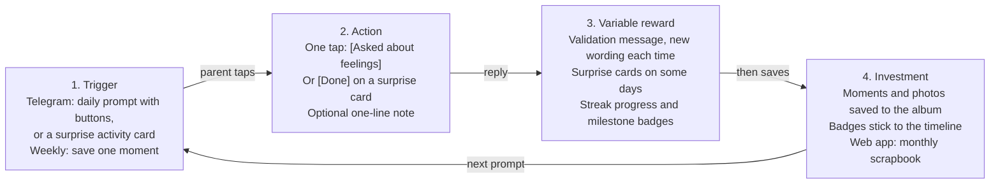

# Family Bond App: MVP Spec for Variable Rewards

29 Oct 2026 · Wei Lieh

> Working notes for Claude Code: this file is the source of truth for fine-tuning. Items marked "(tune)" are starting guesses to adjust after the family test (section 8), not research findings.

## 1. Purpose and scope

This spec defines the five variable-reward features and three milestone badges for the first test of the Family Bond app, a Telegram bot plus a web app that nudges parents of children aged 7-12 to repeat one small bonding action. It covers what each reward does, how it behaves in the chatbot and the web app, and how we will know it works.

**Design principle:** make the action easy first, vary the reward second, and keep every reward informational ("here is what you did") rather than controlling ("do this to earn points"). This follows the Fogg Behavior Model (Motivation, Ability, Prompt must meet at the same moment), where making the action easier is usually more reliable than adding motivation.

**In scope for the MVP (Minimum Viable Product):**

- Feature 1: Personalized validation message
- Feature 2: Surprise activity card
- Feature 3: Weekly streak with repair
- Feature 4: Completion checklist (quick-reply buttons)
- Feature 6: Family memory album (collection from day one, simple web view)
- Feature 10: Three milestone badges

**Out of scope for now** (see section 10): XP (experience points) and levels, co-parent reaction, shared family badges, per-activity badge collection, social benchmarking, time-limited challenges.

## 2. The hook loop

Every reward in this spec feeds one four-step loop from Eyal's Hook Model, and the surprise lives in step 3: the bot prompts, the parent taps once, a varied reward comes back, and what the parent saves makes the next prompt worth answering.

Read the loop clockwise from the top left. The chatbot carries steps 1 to 3 so the action stays one tap; the web app mirrors the rewards and holds the album.

## 3. MVP features at a glance

Only features 1 and 2 are truly variable; features 3, 4 and 6 give structure and stay predictable. That split is deliberate: Eyal argues predictable rewards lose their power, so the surprise lives where it is cheap to produce (wording and activity choice) while the habit scaffolding stays steady.

| Attribute | 1. Validation message | 2. Surprise activity card | 3. Weekly streak with repair | 4. Completion checklist | 6. Family memory album |
| --- | --- | --- | --- | --- | --- |
| Eyal reward category | Tribe (social) | Hunt (information) | Self (progress) | Self (completion) | Self (investment) |
| Role in the hook loop | Variable reward | Variable reward | Predictable reward plus a pull to return | Action (one tap) | Investment |
| What varies | Wording and the detail it mentions | Which activity arrives and when | Nothing (steady) | Nothing (steady) | Nothing (steady) |
| Chatbot (Telegram) | Reply after each log | Occasional replacement for the daily prompt | Progress line after each log | Buttons in the daily prompt | Weekly prompt for a photo or line |
| Web app | Shown on the Today card | Shelf of discovered cards | Weekly ring and passes left | Tick-list that fills in | Monthly scrapbook timeline |
| Main risk | Feels generic or fake | Feels like homework | Broken streak causes quitting | Feels like a chore list | Child photo privacy |

## 4. Feature specs

Numbers marked "tune" are starting guesses to adjust after the family test (section 8), not findings from research.

### Feature 1: Personalized validation message (Tribe)

**What it does:** after the parent logs a bonding moment, the bot replies with a short, warm message that names what they did.

- **Trigger:** a button tap from feature 4, or a free-text line from the parent.
- **Chatbot:** reply within seconds, one message from a library of at least 20 variants matched to the activity logged. Example: after [Asked about feelings], "You asked how she felt, not just what she did. Kids remember that kind of question."
- **Web app:** the latest message appears on the Today card; past messages are kept with the album entry for that day.
- **Rules:** never repeat a variant within the last 10 logs (tune); always mention the specific action; no points, no comparison with other parents; never mention a missed day.
- **Watch out for:** generic cheerleading ("Great job!") reads as fake. Praise the action, not the parent as a person.

### Feature 2: Surprise activity card (Hunt)

**What it does:** on some days the usual prompt is replaced by a small, unexpected activity for the parent and child to do together.

- **Cadence:** about 3 days a week (tune), chosen at random, never two days in a row, never on a day the parent already logged.
- **Chatbot:** one card per message with three buttons: [Done] [Not today] [Swap]. Example: "Surprise: ask your 10-year-old to teach you something they learned this week. 3 minutes, no setup." Swap offers one alternative, once per day.
- **Web app:** a "Cards you've discovered" shelf showing each card done, with its date. No locked slots and no completion count, so it stays a discovery, not a checklist.
- **Content rules:** each card takes about 3 minutes, needs no materials or spending, and suits ages 7-12. Launch with about 30 cards (tune).
- **Watch out for:** cards that feel like homework. Test every card with real families before shipping it.

### Feature 3: Weekly streak with repair (Self)

**What it does:** shows steady progress and gives a gentle reason to come back, without punishing a missed day.

- **Definition:** a week runs Monday to Sunday, Singapore time. The headline is "days this week". The streak counts consecutive weeks with at least 3 logged days (tune).
- **Repair:** one free pass per week lets the parent count one missed day as done, up to 48 hours after the miss (tune). Unused passes do not stack.
- **Chatbot:** a progress line after each log, e.g. "3 days this week." If a week falls short, no "you broke your streak" message. Instead: "New week, fresh start. Here's today's idea."
- **Web app:** a weekly ring showing days done, passes left, and weeks in a row.
- **Why this design:** intact logged streaks increased later engagement in seven studies, but broken streaks led people to drop off, and the effect weakens when a broken streak can be repaired (Silverman and Barasch, 2023). Apps are advised not to focus on broken streaks in their messages.
- **Watch out for:** a strict daily streak. Family life is irregular, and one bad day should not end the habit.

### Feature 4: Completion checklist (Self)

**What it does:** makes logging a moment a single tap and gives the parent a small sense of finishing something.

- **Chatbot:** the daily prompt carries buttons: [Praised effort] [Asked about feelings] [Played together] [Something else] [Skip today]. After the tap, an optional "Want to add one line?" The line feeds feature 6.
- **Web app:** a tick-list of the week that fills in as buttons are tapped.
- **Rules:** Skip is never labelled a failure and has no penalty. Every button logs in one tap with no typing.
- **Why this design:** Fogg's model treats ability (how easy the action is) as the more reliable lever than motivation.
- **Watch out for:** it turning into a chore list. Keep the wording about moments with the child, not tasks.

### Feature 6: Family memory album (Self, investment)

**What it does:** stores small moments the parent chooses to save, so the product becomes more valuable the longer it is used.

- **Chatbot:** a weekly prompt (tune: Sunday evening): "Want to save one moment from this week? Send a photo or one line." Replies and the optional lines from feature 4 are saved with the date and the activity.
- **Web app (MVP view):** a simple monthly timeline of saved lines and photos, visible only to the parent who saved them. Sharing and co-parent access are off.
- **Rules:** photos are optional; the parent can delete any entry; milestone badges (section 5) appear on the timeline.
- **Why start now:** collecting from day one means the album is not empty when richer views are built later.
- **Watch out for:** child photos are sensitive. Review the Personal Data Protection Act (PDPA) and relevant MSF (Ministry of Social and Family Development) guidance before storing any photo; see section 9.

## 5. Feature 10: Three milestone badges (Self)

The MVP carries exactly three permanent badges, awarded for consistency and a first save, not for volume. Their job is small: once earned they cannot be lost, which softens the sting of a broken streak. Yu-kai Chou makes the same point: you can lose a streak, but you cannot lose a permanent badge.

| Attribute | First Steady Week | Four Steady Weeks | First Memory |
| --- | --- | --- | --- |
| Trigger | First week with at least 3 logged days | 4 steady weeks in total, not necessarily in a row | First photo or line saved to the album |
| Chatbot message | "Your first steady week: 3 moments with your child in one week. Badge unlocked: First Steady Week." | "Four steady weeks so far. That's a month of showing up." | "Your first saved memory. It's in your album now." |
| Web app display | Sticker on the album timeline at the week it was earned | Sticker on the timeline at the date earned | Sticker on that first entry |
| Why this badge | Marks the first proof the habit can work | Rewards steadiness even when weeks are not consecutive | Encourages the investment step of the hook loop |

**Rules for all badges**

- Permanent: never removed, and never affected by a broken streak.
- Awarded for effort and consistency only. No badges for number of logs.
- Private to the parent: no leaderboard, no comparison, no sharing in the MVP.
- No locked or empty badge slots, so nothing looks "missing".
- Never paired with points or a prize, and no new badges until the family test review.

**Why only three, and what to watch for:** a meta-analysis of 128 studies found that tangible rewards can have a substantial undermining effect on intrinsic motivation, and even verbal rewards can have a controlling side. Badges that simply report what the parent did sit at the safer, informational end, but the risk is real. During the test, check whether any parent says they logged "for the badge". If so, remove the badges and keep the validation messages.

## 6. Variability rules

The content varies; the response never does. Every logged moment always gets a reply, so a parent is never left feeling unseen. Only the wording, the activity and the timing change. Withholding a reply at random, the way a slot machine does, would be the wrong lesson from Eyal's model for a family-bonding product.

| Attribute | Message wording (feature 1) | Card choice (feature 2) | Card timing (feature 2) |
| --- | --- | --- | --- |
| What varies | Which variant is sent and which detail it names | Which activity arrives | Which days a card replaces the usual prompt |
| How it is chosen | Random among variants matching the logged activity, excluding the last 10 used (tune) | Random among cards not yet seen; repeats only after all are seen | Random, about 3 days a week (tune), never two days in a row, never after a log that day |
| Launch library | At least 20 variants | About 30 cards, roughly 10 weeks before a repeat at 3 a week | Not applicable |
| Fixed rule | Always sent after a log | Always about 3 minutes, no materials | Parent can always still log on a normal day |

**Kept predictable on purpose:** streak counts, badge triggers, checklist buttons and the weekly album prompt. A parent should always know how to log, what counts, and when a badge arrives.

## 7. Starter content (drafts to test with families)

These are working drafts, not tested copy. The launch libraries need at least 20 messages and about 30 cards; this is the first batch that sets the tone: specific, warm, short, no points, no comparison.

### Sample validation messages (feature 1)

| Button tapped | Sample message |
| --- | --- |
| Praised effort | "You noticed the effort, not just the result. That tells your child that trying matters." |
| Praised effort | "Praising the try instead of the score takes practice. You did it today." |
| Asked about feelings | "You asked how your child felt, not just what happened. That kind of question says you want to hear the answer." |
| Asked about feelings | "Making room for feelings takes patience. Today you did." |
| Played together | "Time spent playing together counts. Thanks for joining in." |
| Played together | "You put the day aside and played. That might be the part your child remembers." |
| Something else | "Whatever you did, you made time for your child today. That counts." |
| Something else | "A small moment, noticed and logged. That's how this adds up." |

### Sample activity cards (feature 2)

Each card takes about 3 minutes and needs no materials.

| Type | Card text |
| --- | --- |
| Ask | "Ask your child: what was the funniest thing that happened today? Then tell yours." |
| Ask | "Ask your child to teach you something they learned this week. Be a curious student." |
| Tell | "Tell your child about something you were proud of when you were their age." |
| Tell | "Share one small thing that was tricky for you today and what you did about it." |
| Play | "Play three rounds of 'would you rather' with silly choices." |
| Play | "Take turns drawing each other in 60 seconds. No judging." |
| Do together | "Pick a song and each say what it reminds you of." |
| Do together | "Build a three-sentence story together, one sentence each." |

Chatbot buttons on every card: [Done] [Not today] [Swap].

## 8. Success metrics and test plan

Run the MVP with 5-10 real families for 5 weeks (tune), long enough for a family to reach the Four Steady Weeks badge. Success means parents keep going and feel closer, not that they tap more buttons.

| Question | Measure | Source |
| --- | --- | --- |
| Do parents keep logging? | Logged days per week per family; number of steady weeks (3 or more days) | Bot logs |
| Is the action easy enough? | Share of daily prompts that get a log; share of logs that are one-tap vs typed | Bot logs |
| Do the surprise cards land? | Done, Not today and Swap rates per card; cut cards with high Not today or Swap | Bot logs |
| Does the repair option help? | Share of families who return the week after a short week | Bot logs |
| Do parents feel closer? | A 1-5 rating of "how connected do you feel with your child this week?" at weeks 1 and 5, plus "what changed?" | Short in-chat check-in |
| Is the reward crowding out the real thing? | Logs bunched on the last day of the week; any parent saying they logged "for the streak or badge" | Bot logs, end-of-test interview |
| Do parents trust the album? | Photos saved, entries deleted, comments on privacy | Bot logs, end-of-test interview |

**Before the test starts:** write down a pass line for each measure. At the review, keep what clears its line and cut what does not.

**At the review, decide:** whether to keep the three badges, whether any Later item (co-parent reaction, shared family badges, XP) is now worth building, and which messages and cards to rewrite.

## 9. Guardrails

Three guardrails apply to every feature above: pass Eyal's ethics test, protect child content, and keep the tone free of pressure.

### Ethics: the Manipulation Matrix

Eyal asks two questions before building a habit-forming feature: would the designer use the product themselves, and does it materially improve the user's life. Two yes answers make the builder a "Facilitator". Apply it at every review: would you use this with your own family, and does it make family life better? If a feature fails either question, cut it.

### Privacy for child content

- Review the Personal Data Protection Act (PDPA) and relevant MSF (Ministry of Social and Family Development) guidance before storing any child photo. Until that is done, make photos optional or text-only.
- Collect the least needed: a first name or nickname the parent chooses, no school, no full name (tune).
- Album entries are private to the parent who saved them; sharing is off in the MVP; the parent can delete any entry.
- This is a prototype. If it ever moves toward an official service, expect a formal privacy and security review.

### Tone and pressure

- No guilt, no comparison with other parents, no "you missed a day" messages.
- No countdowns, limited-time offers or fear-of-missing-out wording.
- One daily prompt plus the weekly album prompt, nothing more. The parent can pause prompts at any time.
- No claims about child development outcomes in messages or cards unless backed by a source.

## 10. Later, skipped, and open questions

Six ideas stay out of the MVP; none should be built before the family test review.

| Feature | Status | Why | Revisit when |
| --- | --- | --- | --- |
| 5. Co-parent reaction (Tribe) | Later (v1.5) | Strong for bonding, but needs two linked accounts and more logic | Core loop holds and parents ask for it |
| 12. Shared family badges (Tribe) | Later | Fits bonding better than individual badges, but depends on feature 5 | After feature 5 |
| 7. XP and levels (Self) | Later, or skip | Extrinsic and predictable; may crowd out genuine motivation | Only if engagement drops and badges are not enough |
| 11. Per-activity badge collection | Skip for now | Easy to turn into points for everything | Not planned |
| 8. Social benchmarking (Tribe) | Skip for now | No cohort data yet; comparison can make parents feel judged | Large user base and real data |
| 9. Time-limited weekend challenge | Skip for now | Pressure suits short bursts, not a bonding habit | Not planned |

### Open questions

- [ ] Is the streak threshold (3 logged days a week) and the 48-hour pass window right for real families?
- [ ] Are photos allowed in the MVP, or text-only until the privacy review is done?
- [ ] Who writes and reviews the 20 messages and 30 cards before launch?
- [ ] What time of day does the daily prompt go out, and can a parent change it?
- [ ] Do the cards fit the families in the test, or do some need rewriting for local context?

### Sources consulted

These came from search results; the full pages were not opened.

- [Nir Eyal on variable rewards (BizPlan)](https://www.bizplan.com/library/videos/series/hooked?track=4)
- [Nir Eyal, Variable Rewards](https://www.nirandfar.com/2012/03want-to-hook-your-users-drive-them-crazy.html)
- [Hooked summary and Manipulation Matrix (SuperSummary)](https://www.supersummary.com/hooked/summary/)
- [Fogg Behavior Model](https://behaviormodel.org/)
- [Fogg Behavior Model overview](https://concepts.dsebastien.net/concept/fogg-behavior-model/)
- [Silverman and Barasch (2023), broken streaks, Journal of Consumer Research](https://www.colorado.edu/business/faculty-research/2023/04/19/or-track-how-broken-streaks-affect-consumer-decisions)
- [Streaks research summary (phys.org)](https://phys.org/news/2024-03-streaks.pdf)
- [Yu-kai Chou, Streak Design](https://yukaichou.com/?p=38981)
- [Deci, Koestner and Ryan (2001), extrinsic rewards and intrinsic motivation](https://www.selfdeterminationtheory.org/SDT/documents/2001_DeciKoestnerRyan.pdf)
- [Gamification and Family Housework Applications](https://dl.ifip.org/IFIP-LNCS-9353/hal-01758462)
